# Contract: database schema outline (v1)

- Status: **Proposed, frozen on approval**. Owner after freeze: Agent A. Changes go through a change request (`docs/contracts/change-requests/`).
- PostgreSQL 18. Schemas: `app` (domain), `audit` (append-only audit), `import` (staging), `pgboss` (queue, managed by pg-boss).

## Global conventions

- Tables `snake_case`, plural. Columns `snake_case`.
- Primary key `id uuid DEFAULT uuidv7()`.
- Every mutable table has `created_at timestamptz NOT NULL DEFAULT now()`, `created_by uuid`, `updated_at`, `updated_by`.
- Soft delete: `archived_at timestamptz`, `archived_by uuid`, `archive_reason text`. No hard deletes on people, finance or audit data. Partial indexes `WHERE archived_at IS NULL`.
- Money: `bigint` in pesewas, column suffix `_pesewas`, `CHECK (... >= 0)` unless a signed amount is the point (ledger).
- Encrypted columns: suffix `_enc bytea` (AES-256-GCM ciphertext with key id); searchable ones also get `_bidx bytea` (HMAC-SHA256 blind index).
- Enums are PostgreSQL `enum` types only for stable sets (payment method, status); admin-configurable lists are tables.
- Optimistic locking: `version int NOT NULL DEFAULT 1` on editable records; API sends `If-Match`.

## Entity relationship diagram (core)

```mermaid
erDiagram
  SCHOOL_PROFILE ||--o{ ACADEMIC_YEARS : has
  ACADEMIC_YEARS ||--|{ TERMS : has
  LEVELS ||--o{ CLASSES : "grouped by"
  ACADEMIC_YEARS ||--o{ CLASSES : "per year"
  STAFF ||--o{ CLASSES : "class teacher"
  STUDENTS ||--o{ ENROLMENTS : "placement history"
  CLASSES ||--o{ ENROLMENTS : contains
  STUDENTS ||--o| STUDENT_MEDICAL : "restricted"
  STUDENTS ||--o{ STUDENT_DOCUMENTS : uploads
  FILES ||--o{ STUDENT_DOCUMENTS : stores
  STUDENTS ||--o{ STUDENT_GUARDIANS : ""
  GUARDIANS ||--o{ STUDENT_GUARDIANS : ""
  STUDENTS ||--o{ EMERGENCY_CONTACTS : "ordered"
  STUDENTS ||--o{ AUTHORISED_PICKUPS : ""
  STUDENTS ||--o{ EMERGENCY_CONTACT_LOGS : ""
  STUDENTS ||--o{ STUDENT_STATUS_HISTORY : ""
  PROMOTION_RUNS ||--|{ PROMOTION_RUN_ITEMS : ""
  STUDENTS ||--o{ PROMOTION_RUN_ITEMS : ""
  CLASSES ||--o{ ATTENDANCE_SESSIONS : ""
  ATTENDANCE_SESSIONS ||--|{ ATTENDANCE_RECORDS : ""
  STUDENTS ||--o{ TERM_SCORES : ""
  SUBJECTS ||--o{ TERM_SCORES : ""
  STUDENTS ||--o{ REPORT_CARDS : ""
  FEE_STRUCTURES ||--|{ FEE_STRUCTURE_LINES : ""
  FEE_ITEMS ||--o{ FEE_STRUCTURE_LINES : ""
  STUDENTS ||--o{ INVOICES : ""
  TERMS ||--o{ INVOICES : ""
  INVOICES ||--|{ INVOICE_LINES : ""
  STUDENTS ||--o{ PAYMENTS : ""
  GUARDIANS ||--o{ PAYMENTS : "paid by"
  PAYMENTS ||--o{ PAYMENT_ALLOCATIONS : ""
  INVOICE_LINES ||--o{ PAYMENT_ALLOCATIONS : ""
  STUDENTS ||--o{ ADJUSTMENTS : ""
  STUDENTS ||--o{ LEDGER_ENTRIES : "sub-ledger"
  PAYMENTS ||--o{ LEDGER_ENTRIES : ""
  INVOICE_LINES ||--o{ LEDGER_ENTRIES : ""
  ADJUSTMENTS ||--o{ LEDGER_ENTRIES : ""
  STUDENTS ||--o{ WITHDRAWALS : ""
  STUDENTS ||--o{ INCIDENTS : ""
  STUDENTS ||--o{ HEALTH_VISITS : ""
  MESSAGES ||--|{ MESSAGE_RECIPIENTS : ""
  MESSAGE_RECIPIENTS ||--o{ DELIVERY_ATTEMPTS : ""
  USERS ||--o{ USER_SESSIONS : ""
  USERS ||--o| STAFF : "may be"
  GUARDIANS |o--o| USERS : "v2 portal"
```

## Tables

### 1. Configuration

| Table | Key columns | Notes |
|---|---|---|
| `school_profile` | name, school_code (3 letters, e.g. `KSV`), motto, address, phone, email, logo_file_id, timezone (`Africa/Accra`), currency (`GHS`) | Single row (`CHECK (id = 1)` style singleton). `school_code` is locked after the first student is created. |
| `settings` | key text PK, value jsonb, updated_by | Policy switches: `promotion.block_on_arrears` (off/warn/block), `attendance.sms_on_absence`, `finance.allocation_order`, retention periods, etc. Validated by a Zod schema per key. |
| `academic_years` | name (`2026/2027`), start_date, end_date, status (`planned`,`current`,`closed`) | Exactly one `current` (partial unique index). |
| `terms` | academic_year_id, number (1..3), name, start_date, end_date, status | `UNIQUE(academic_year_id, number)`. |
| `levels` | code (`KG1`, `P1`, `JHS3`), name, sort_order, is_final_level, next_level_id | Admin-configurable list. Seeded with Creche, Nursery, KG1, KG2, P1–P6, JHS1–JHS3. |
| `classes` | academic_year_id, level_id, stream (`A`,`B`,…, nullable), display_name, capacity, class_teacher_staff_id | `UNIQUE(academic_year_id, level_id, stream)`. Classes are per academic year. |
| `subjects` | code, name, is_active | |
| `level_subjects` | level_id, subject_id, sort_order | Subjects taught per level. |
| `grading_scales` / `grading_bands` | scale: name, applies_to_level_ids; band: min_score, max_score, grade, remark, sort_order | Bands cannot overlap (exclusion constraint on `int4range`). |
| `assessment_config` | level_id, class_score_weight, exam_score_weight | e.g. 30/70 or 50/50. |
| `id_counters` | scope (`student:26`), last_value | Row-locked by `app.next_student_id(year)`. |
| `doc_counters` | doc_type (`receipt`, `reversal`, `invoice`, `transfer_letter`), prefix, last_value | Gap-free, row-locked in the business transaction. |

### 2. Students and safety

| Table | Key columns | Notes |
|---|---|---|
| `students` | **student_code** (unique, permanent, e.g. `KSV-26-00417-7`), admission_year, admission_seq, first_name, middle_names, last_name, preferred_name, date_of_birth, gender, nationality, home_address, previous_school, admission_date, admission_class_id, photo_file_id, birth_cert_no (nullable), religion (nullable), languages text[], status (`applicant`,`active`,`withdrawn`,`transferred_out`,`graduated`/alumni,`deceased`), search_vector tsvector, version, archived_* | `student_code` has `UNIQUE` and a trigger that forbids changing it. `UNIQUE(admission_year, admission_seq)`. Trigram index on full name. |
| `student_medical` | student_id PK/FK, blood_group, allergies_enc, chronic_conditions_enc, medication_notes_enc, special_needs_enc, doctor_name, clinic_name, clinic_phone, **alert_summary** (short plain text e.g. "Severe peanut allergy, carries EpiPen"), has_alert bool | Separate table so access is a separate permission. `alert_summary` is shown on Emergency View; full detail needs `medical:read`. |
| `files` | id, storage_key (random), original_name, mime_type (detected, not trusted from client), size_bytes, sha256, scan_status (`pending`,`clean`,`infected`,`error`), uploaded_by | Only `clean` files can be downloaded. |
| `student_documents` | student_id, file_id, doc_type (`birth_certificate`,`previous_report`,`passport_photo`,`transfer_letter`,`other`), notes | |
| `guardians` | first_name, last_name, title, phone_primary (E.164 `+233…`), phone_secondary, whatsapp_number, email, occupation, workplace, home_address, work_address, ghana_card_enc, ghana_card_bidx, ghana_card_last4, **user_id (nullable, v2 portal)**, version, archived_* | Index on phone numbers for search and duplicate checks. |
| `student_guardians` | student_id, guardian_id, relationship (`mother`,`father`,`grandparent`,`aunt`,`uncle`,`sibling`,`guardian`,`other`), is_primary, is_fee_payer, can_pick_up, lives_with_student, receives_sms | PK (student_id, guardian_id). At most one `is_primary` per student (partial unique index). |
| `v_sibling_links` (view) | student_id, sibling_student_id, via_guardian_ids | Siblings derived automatically from shared guardians. Never stored, so never out of date. |
| `emergency_contacts` | student_id, priority (1..n), guardian_id (nullable) **or** name + phone + relationship, notes | `UNIQUE(student_id, priority)` deferrable so the list can be re-ordered in one transaction. |
| `authorised_pickups` | student_id, guardian_id or name, relationship, phone, photo_file_id, id_type, id_number_last4, verification_notes, valid_from, valid_to | |
| `emergency_contact_logs` | student_id, contact_ref, phone_called, outcome (`reached`,`no_answer`,`wrong_number`,`message_left`), notes, contacted_by, contacted_at | Append-only. |
| `student_status_history` | student_id, from_status, to_status, effective_date, reason, source (`admission`,`promotion`,`withdrawal`,`manual`), source_ref_id | Append-only. |

### 3. Enrolment and promotion

| Table | Key columns | Notes |
|---|---|---|
| `enrolments` | student_id, class_id, academic_year_id, roll_number, start_date, end_date (nullable), status (`active`,`completed`,`repeated`,`withdrawn`,`moved`), reason, promotion_run_id | Never overwritten: a class change closes one row (`end_date`) and opens another. Partial unique: one open enrolment per student; `UNIQUE(class_id, roll_number) WHERE end_date IS NULL`. |
| `promotion_runs` | from_academic_year_id, to_academic_year_id, scope (class ids), status (`draft`,`committed`,`undone`), committed_at, committed_by, undo_deadline (default committed_at + 14 days), undone_at, undone_by, arrears_policy_snapshot | |
| `promotion_run_items` | run_id, student_id, from_enrolment_id, action (`promote`,`repeat`,`skip`,`withdraw`,`transfer_out`,`graduate`), target_class_id, outstanding_pesewas_snapshot, arrears_flag, override_reason, created_enrolment_id | Undo reverses exactly the rows this run created (closes new enrolments, reopens old ones, restores statuses) in one transaction, and only if nothing later depends on them (e.g. no invoices issued in the new year for that student without voiding first). |

### 4. Staff

| Table | Key columns | Notes |
|---|---|---|
| `staff` | staff_code, first_name, last_name, gender, date_of_birth, phone, email, address, staff_type (`teaching`,`non_teaching`), job_title, employment_date, status, ghana_card_enc, ssnit_no_enc, user_id (nullable), archived_* | |
| `staff_emergency_contacts` | staff_id, priority, name, relationship, phone | |
| `staff_class_assignments` | staff_id, class_id, subject_id (nullable), role (`class_teacher`,`subject_teacher`,`assistant`), start_date, end_date | Drives TEACHER role scope. |

### 5. Attendance, academics, welfare

| Table | Key columns | Notes |
|---|---|---|
| `attendance_sessions` | class_id, date, session (`am`; `pm` optional), taken_by, taken_at | `UNIQUE(class_id, date, session)`. |
| `attendance_records` | session_id, student_id, status (`present`,`absent`,`late`,`excused`), reason_code, note, sms_message_id | |
| `term_scores` | term_id, class_id, subject_id, student_id, class_score, exam_score, total (generated), grade, subject_remark, entered_by, locked_at | Scores as `numeric(5,2)` (not money). `UNIQUE(term_id, subject_id, student_id)`. |
| `report_cards` | term_id, student_id, class_id, overall_total, average, position, class_size, attendance_present, attendance_total, conduct, interest, class_teacher_remark, head_remark, next_term_begins, status (`draft`,`published`), pdf_file_id | Positions computed with ties ("joint 3rd"). |
| `incidents` | student_id, occurred_at, category, severity, description, action_taken, reported_by, guardian_informed_at, follow_up | Restricted. |
| `health_visits` | student_id, visited_at, complaint, treatment_given, medication_given, sent_home bool, guardian_informed_at, attended_by | Restricted (medical). |
| `withdrawals` | student_id, type (`withdrawal`,`transfer_out`), reason, effective_date, destination_school, clearance (jsonb checklist: fees, books, uniform, property, with who/when), status (`pending_clearance`,`completed`,`cancelled`), transfer_letter_file_id, letter_no | Completing it sets student status and closes the enrolment. |

### 6. Finance (append-only)

| Table | Key columns | Notes |
|---|---|---|
| `fee_items` | code, name, category (`tuition`,`pta`,`feeding`,`transport`,`uniform`,`books`,`exams`,`extracurricular`,`other`), is_optional, is_active, allocation_priority | |
| `fee_structures` | academic_year_id, term_id, level_id, class_id (nullable override), name, status (`draft`,`active`,`retired`), activated_by | One active structure per (term, level[, class]). Immutable once active; change by retiring and creating a new one. |
| `fee_structure_lines` | fee_structure_id, fee_item_id, amount_pesewas, is_optional | |
| `student_optional_items` | student_id, term_id, fee_item_id, opted_in | e.g. transport, feeding opt-ins. |
| `invoices` | invoice_no (gap-free), student_id, term_id, class_id, issue_date, due_date, opening_balance_pesewas (snapshot from ledger), total_pesewas, status (`issued`,`void`), void_reason, voided_by, generation_batch_id | `UNIQUE(student_id, term_id) WHERE status='issued'`. |
| `invoice_lines` | invoice_id, fee_item_id, description, amount_pesewas | |
| `payments` | **receipt_no** (gap-free, unique), student_id, payer_guardian_id (nullable), payer_name, amount_pesewas (`> 0`), method (`cash`,`bank_transfer`,`cheque`,`momo_mtn`,`telecel_cash`,`at_money`), reference_no, reference_key (normalised `method:upper(trim(ref))`, non-unique index for duplicate warnings), bank_name, cheque_no, received_at, recorded_by, notes, attachment_file_id, **status** (`confirmed`,`reversed`; v2 adds `pending`,`failed`), **source** (`manual`; v2 adds `gateway`), **provider** (nullable, v2), **external_reference** (unique nullable, v2), **idempotency_key** (unique, not null), idempotency_request_hash, duplicate_override_reason, cash_up_id | The only `UPDATE` allowed is `status confirmed → reversed`, done by a SECURITY DEFINER function in the same transaction as the reversal entry. |
| `payment_allocations` | payment_id, invoice_line_id (nullable = unallocated credit), amount_pesewas, allocation_batch_id, is_reversal | Re-allocation adds negative rows + new rows; never edits. |
| `adjustments` | student_id, term_id, type (`discount`,`scholarship`,`bursary`,`sibling_discount`,`waiver`,`refund`,`write_off`,`manual_charge`), fee_item_id (nullable), amount_pesewas, percent_bp (basis points, nullable), reason (required), status (`pending`,`approved`,`rejected`,`reversed`), requested_by, approved_by (must differ from requested_by, `CHECK`), approved_at | Only approved adjustments post to the ledger. |
| `ledger_entries` | student_id, entry_no (bigserial), posted_at, term_id, entry_type (`invoice_charge`,`payment`,`adjustment`,`reversal`,`opening_balance`), amount_pesewas (signed: **+ = owed by family, − = paid/credited**), invoice_line_id, payment_id, adjustment_id, reverses_entry_id (unique), description, posted_by | **Append-only** (trigger raises on UPDATE/DELETE; no grant). Balance = `SUM(amount_pesewas)`; negative = credit. `reverses_entry_id` unique so nothing is reversed twice. |
| `cash_ups` | business_date, opened_by, closed_by, closed_at, expected_by_method jsonb, counted_by_method jsonb, variance_pesewas, notes, status (`open`,`closed`) | Payments link to the open cash-up for the day. After close, reversing needs admin approval. |
| `mv_student_balances` (materialised view, refreshed on commit via queue + on demand) | student_id, balance_pesewas, last_payment_at, oldest_unpaid_term_id | Fast list screens; live single-student balance always reads the ledger directly. |

### 7. Communication

| Table | Key columns | Notes |
|---|---|---|
| `message_templates` | code (`fee_reminder`, `absence_alert`, `announcement`, `closure_notice`, `emergency`), channel (`sms`,`whatsapp`), body with `{{placeholders}}`, is_active | Placeholders validated against an allow-list per template code. |
| `messages` | kind, channel, template_id, body_rendered_preview, audience (jsonb: class/level/school/student ids), status (`queued`,`sending`,`done`,`partially_failed`), requested_by, approved_by (bulk > N needs admin), scheduled_for | |
| `message_recipients` | message_id, guardian_id, student_id, phone, body, status (`queued`,`sent`,`delivered`,`failed`,`skipped_opt_out`), provider_message_id, cost_units | |
| `delivery_attempts` | recipient_id, attempt_no, attempted_at, provider, response_code, error | |

### 8. Import staging (`import` schema)

| Table | Key columns | Notes |
|---|---|---|
| `import.jobs` | type (`students_guardians`,`staff`,`opening_balances`), file_id, status (`uploaded`,`validated`,`committing`,`committed`,`failed`), totals jsonb, dry_run_report_file_id, error_report_file_id, created_by, committed_by | |
| `import.rows` | job_id, row_number, raw jsonb, normalised jsonb, status (`valid`,`warning`,`error`,`duplicate`), messages jsonb, target_student_id, target_guardian_ids | Commit runs in batches of 200 inside transactions; re-runnable (idempotent on `job_id,row_number`). |

### 9. Security and audit

| Table | Key columns | Notes |
|---|---|---|
| `users` | username, email, full_name, password_hash (Argon2id), user_type (`staff`; v2 `guardian`), roles text[] (`ADMIN`,`BURSAR`,`HEADTEACHER`,`REGISTRAR`,`TEACHER`), status (`active`,`locked`,`disabled`), mfa_enabled, mfa_secret_enc, mfa_recovery_codes_hash text[], failed_login_count, locked_until, password_changed_at, must_change_password, last_login_at, staff_id | MFA required for ADMIN and BURSAR (login refused until enrolled). |
| `user_sessions` | id (random 256-bit, stored hashed), user_id, created_at, last_seen_at, expires_at, idle_expires_at, ip, user_agent, mfa_verified_at, revoked_at, revoked_reason | Idle timeout 30 min, absolute 12 h. |
| `password_reset_tokens` | user_id, token_hash, expires_at (30 min), used_at | Admin-initiated reset as well as email reset. |
| `login_attempts` | username_tried, ip, succeeded, reason, at | For lockout and rate limits. |
| `idempotency_records` | key, user_id, route, request_hash, response_status, response_body, created_at | 7-day retention; used by POST /payments and other money endpoints. |
| `audit.events` | id bigserial, occurred_at, actor_user_id, actor_role, session_id, ip, action (`view`,`create`,`update`,`delete`,`archive`,`export`,`login`,`login_failed`,`emergency_view`,`reveal_sensitive`,`approve`,`reverse`, …), entity_type, entity_id, student_id (nullable, for "who looked at this child"), changes jsonb (field-level before/after; sensitive values masked), reason, request_id, prev_hash, hash | **Append-only** with SHA-256 hash chain; trigger forbids UPDATE/DELETE; separate DB role. Daily chain verification job. |
| `data_subject_requests` | requester_name, relationship, student_id/guardian_id, type (`access`,`correction`,`deletion`,`objection`), received_at, due_at (received + 21 days per Act 843 practice; confirm), status, handled_by, outcome, response_file_id | |
| `retention_actions` | entity_type, entity_id, action (`anonymised`,`archived`), basis, approved_by, performed_at | |

## Required database functions and triggers (Agent A)

1. `app.next_student_code(admission_year int) returns text` – row lock on `id_counters`, Damm check digit, format `{school_code}-{yy}-{seq:05d}-{check}`.
2. `app.next_doc_no(doc_type text) returns text` – gap-free, row lock; must be called inside the business transaction.
3. `app.forbid_update_delete()` – trigger used on `ledger_entries`, `audit.events`, `emergency_contact_logs`, `student_status_history`, `payment_allocations`, `invoice_lines`.
4. `app.guard_payment_update()` – only `status: confirmed → reversed` allowed.
5. `app.forbid_student_code_change()`.
6. Audit hash chain trigger on `audit.events`.
7. DB roles: `sms_owner` (migrations), `sms_app` (no UPDATE/DELETE on finance/audit), `sms_audit_writer` (INSERT only on audit), `sms_readonly` (reports/backups).
